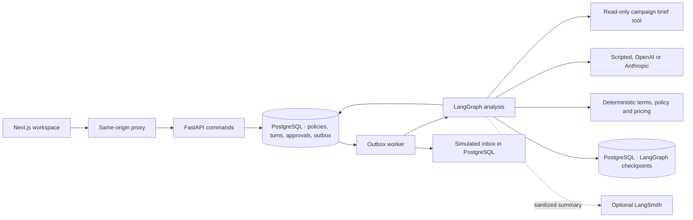

# Dealroom architecture

## State and recovery

A negotiation revision changes when new input, closure, reopening, or an explicit reanalysis supersedes a draft. Creator policy versions are immutable. An analysis uses the version bound to its job. Explicit rules own pricing and restrictions. The current thread's prior structured offer preserves commercial context, and scoped preference references can appear as evidence. LangGraph uses the analysis job ID as its checkpoint thread. It can resume extraction, pricing, or composition without holding a business transaction open.

An inbound message or creator approval commits together with its outbox job. Claims use PostgreSQL row locks and expiring leases. A per-job advisory lock serializes graph writes, and the lease token guards acknowledgment. A stale analysis can preserve its extracted offer for the next turn, while publishing a draft requires the current revision and policy. After bounded retries, operational failures appear in the timeline and can be restarted. Session and fixture cleanup remove associated analysis checkpoints.

Approval records the draft identifier, version, content digest, negotiation revision and policy version. The delivery transaction locks the current negotiation, verifies those bindings and writes a unique receipt to the same database. Retrying a committed delivery returns its existing receipt. The recovery controls can interrupt after a durable analysis checkpoint or after simulated delivery commits and before the worker acknowledges its job. The tests also replace the worker with a fresh process between attempts. An external email provider would require its own idempotency and reconciliation strategy.

## Boundaries and trade-offs

- The model produces structured extraction and presentation choices. Code validates and renders the email. The versioned editor changes tone and follow-up language, which keeps commercial terms under deterministic validation.
- The scripted adapter uses bounded pattern extraction for supported synthetic inputs. The configured live model can interpret broader language. The published evaluation artifact uses scripted mode and includes expected and observed assertion values.
- The same-origin proxy keeps browsers away from provider credentials. The application derives the tenant from an opaque, HTTP-only session token and scopes reads and writes by tenant. Demo quotas and a session-creation burst limit keep the public sandbox bounded. The demo expects all email bodies to be synthetic.
- Structured offer snapshots and scoped preference references fit the sandbox data. A larger corpus would need retrieval and freshness evaluation before adding search infrastructure.
- The application timeline reports durable state, policy checks, tool summaries and measured usage. LangSmith is optional and receives a separate sanitized summary. The prototype keeps application data in PostgreSQL and uses provider-dependent telemetry for live usage.

## Linked campaign brief evidence

The workflow checks for links before extraction. Turns with a link route through the LangChain `read_campaign_brief` tool, which resolves registered synthetic documents from the local catalog. It ranks relevant sections, loads up to three unique links and three sections per document, and parses typed facts from allowed commercial sections. The checkpoint stores the observations and their provenance. Resuming after pricing reuses that evidence. Link-free turns skip retrieval, and link reading consumes no provider calls.

The current email takes precedence over document observations. Conflicting or unavailable brief terms can trigger clarification before an acceptance recommendation. Arbitrary URLs never reach a network client. The inspector links back to the catalog document and shows its revision, selected section IDs, and retrieval latency. The external trace receives bounded counts and timings. Version 2 of the scripted suite compares document IDs, selected sections, extracted rights, blocked links and the resulting negotiation decision.

## Negotiation moves and sender evidence

The `select_negotiation_move` tool receives policy-checked terms and the last delivered counteroffer under the current policy. It picks an opening quote, a held quote, repricing after a scope change, a clarification, a conditional confirmation, or a decline. A pending or rejected draft cannot anchor a reply. An explicitly separate higher production budget is preserved, and licensing or exclusivity can be discussed independently. A reply can offer a conditional scope alternative while leaving pricing and approval under creator control.

The sender check compares the top-level display name with normalized mailbox tokens or the closing signature. An email address without a display name needs a corroborating signature. Conflicting signals use a neutral greeting. This establishes consistency within the email. Identity authentication belongs to the mail integration. The agent inspector records only the evidence class and negotiation move, with no personal name in the external trace.

Copy is rendered from checked facts and one prioritized question. The model can select presentation without changing amounts or approval rights. Persisted drafts retain the exact body reviewed by the creator. Version 3 of the scripted suite adds sender, budget, delivered-quote continuity, and reply-length checks.

## Production handoff boundaries

The default workspace isolates synthetic negotiation data by session. Creator workspaces use verified assertions from a trusted identity gateway and database membership. Inbound mail arrives as an authenticated relay event. An approval locks the sender, recipient, subject, exact body digest and approving actor. The relay contract returns a durable receipt or requires lookup of the original delivery key. An unknown outcome blocks another approval until reconciliation. See the [real-mail integration](real-mail-integration.md).

Negotiation and evaluation jobs run in separate production lanes. A lease renewal and heartbeat identify the active worker. The API pins the workflow revision and model identity into analysis jobs. Workers claim matching jobs, and the operations endpoint reports worker coverage, queue age and terminal failures.

A failed predecessor must be explicitly retried or skipped before a later analysis resumes. Each successful turn uses the most recent completed terms, and new checkpoints retain derived terms and decisions while reading raw email and policy from their existing records. Local presentation keeps successful live turns at one model extraction call. OpenAI requests specify `store=False`. Provider organization settings and application storage remain separate data controls.

Conditional snapshots use ETags and the browser slows polling when idle. The initial snapshot carries the latest 100 audit events. An older-events cursor preserves access to the earlier timeline. [Operations and rollback](operations.md)
